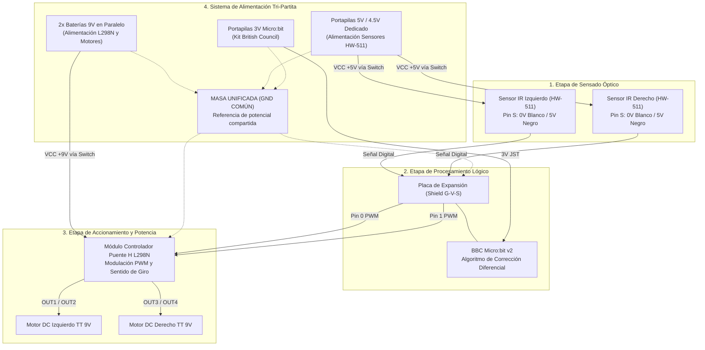
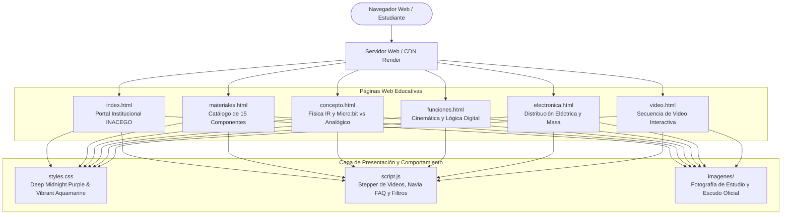

# 🤖 Robot Seguidor de Línea Móvil Rover Mini — BBC Micro:bit v2 & L298N
> **Institución Educativa Acevedo y Gómez (INACEGO) — Puerto Rico, Caquetá**  
> *Lema Institucional:* *"Servimos a la Comunidad y Formamos para la Vida"*  
> **Área:** Tecnología e Informática · Grado 11° de Educación Media Técnica  
> **🌐 Sitio Web Oficial en Producción:** [https://mi-primer-robot.onrender.com](https://mi-primer-robot.onrender.com)  
> **📦 Repositorio GitHub:** [https://github.com/Stellel-One/Mi-Primer-Robot](https://github.com/Stellel-One/Mi-Primer-Robot)

---

## 📑 Tabla de Contenidos

1. [Presentación del Proyecto](#-presentación-del-proyecto)
2. [Arquitectura General del Sistema](#-arquitectura-general-del-sistema)
3. [Lista de Materiales y Componentes (BOM)](#-lista-de-materiales-y-componentes-bom)
4. [Mapa de Conexiones y Pinout](#-mapa-de-conexiones-y-pinout)
5. [Distribución Eléctrica y Masa Común](#-distribución-eléctrica-y-masa-común)
6. [Lógica de Control y Algoritmo de Decisión](#-lógica-de-control-y-algoritmo-de-decisión)
7. [Guía de Ensamblaje Paso a Paso](#-guía-de-ensamblaje-paso-a-paso)
8. [Arquitectura de la Plataforma Web](#-arquitectura-de-la-plataforma-web)
9. [Instrucciones de Ejecución Local y Despliegue](#-instrucciones-de-ejecución-local-y-despliegue)
10. [Créditos e Identidad Institucional](#-créditos-e-identidad-institucional)

---

## 🏫 Presentación del Proyecto

Este proyecto pedagógico y técnico documenta el diseño, ensamblaje, calibración y programación de un **Robot Seguidor de Línea Móvil Autónomo de Tracción Diferencial**. 

El vehículo utiliza como cerebro de procesamiento una tarjeta **BBC Micro:bit v2** montada sobre una placa de expansión (*shield* tipo Sensor:bit con conectores de triple pin **G-V-S**), una etapa de potencia basada en el controlador **Puente H L298N**, y dos sensores ópticos infrarrojos de contraste **HW-511 (KY-033)** montados sobre un chasis acrílico **Rover Mini**.

Acompañando al prototipo físico, este repositorio aloja la plataforma web educativa de alta fidelidad desarrollada para guiar a los estudiantes de Grado 11° en cada fase del proceso de robótica.

---

## 🔬 Arquitectura General del Sistema



---

## 📋 Lista de Materiales y Componentes (BOM)

El prototipo consta de **15 componentes esenciales**, seleccionados para garantizar robustez mecánica y fiabilidad eléctrica:

| # | Componente | Denominación / Referencia Exacta | Cant. | Función en el Robot |
|:---:|:---|:---|:---:|:---|
| **01** | **Tarjeta Controladora** | BBC Micro:bit v2 (Kit British Council) | 1 | Microcontrolador principal; procesa la lógica de control, lee los sensores y genera señales PWM de velocidad. |
| **02** | **Placa de Expansión** | Shield Breakout para Micro:bit (Sensor:bit G-V-S) | 1 | Expande los pads pequeños de la Micro:bit a hileras ordenadas de pines GND, VCC y Señal. |
| **03** | **Controlador de Motores** | Módulo Driver Puente H L298N | 1 | Etapa de potencia que regula la velocidad y el sentido de giro de los dos motores DC. |
| **04** | **Sensores Infrarrojos** | Módulos seguidores de línea HW-511 (o KY-033) | 2 | Detección óptica de la línea negra sobre fondo blanco mediante emisor IR y fototransistor con comparador LM393. |
| **05** | **Chasis del Robot** | Kit Chasis "Rover Mini" de acrílico | 1 | Plataforma estructural que aloja los motores, baterías, placas electrónicas y tornillería. |
| **06** | **Motores de Tracción** | Motores DC tipo TT 9V con caja reductora | 2 | Proporcionan el par motor y movimiento independiente a las ruedas laterales. |
| **07** | **Ruedas Principales** | Ruedas de goma de alta adherencia para chasis Rover | 2 | Transmiten la tracción mecánica de los motores hacia la pista de prueba. |
| **08** | **Rueda Trasera** | Rueda loca pivotante (*Caster Wheel*) | 1 | Otorga estabilidad estática y rotación libre omnidireccional en la parte trasera del chasis. |
| **09** | **Accesorios Rueda Loca** | 4 extensores cilíndricos metálicos + 8 tornillos | 1 set | Ajustan la altura y nivelación de la rueda loca respecto al plano del chasis. |
| **10** | **Encoders Ópticos** | Discos ranurados de codificación para eje de motor | 2 | Medición opcional de odometría, distancia y revoluciones por minuto. |
| **11** | **Fuente Motores** | 2 baterías de 9V (conectadas en paralelo) | 2 | Suministran corriente continua de 9V al Puente H y motores con mayor autonomía de corriente. |
| **12** | **Fuente Sensores IR** | Portapilas independiente (~4.5V a 5V) | 1 | Energiza exclusivamente los sensores IR a 5V para garantizar lecturas estables y fiables. |
| **13** | **Fuente Micro:bit** | Portapilas de 3V propio del kit Micro:bit (2x AAA) | 1 | Alimentación dedicada para la tarjeta lógica Micro:bit vía conector JST. |
| **14** | **Interruptores** | Interruptores basculantes (*Toggle Switch*) | 2 | Control de encendido/apagado independiente para el circuito de motores y el de sensores. |
| **15** | **Cableado y Ferretería** | Jumpers Dupont H-H / M-H, caimanes, tornillos M3, tuercas, arandelas y foami aislante | 1 set | Interconexión eléctrica flexible, sujeción mecánica y aislamiento galvánico de baterías. |

---

## 🔌 Mapa de Conexiones y Pinout

### Tabla de Interconexión Pin a Pin

| Origen (Micro:bit / Shield) | Destino (Módulo / Componente) | Pin Destino | Descripción de la Señal |
|:---|:---|:---|:---|
| **Pin 0** | Puente H L298N | Entrada PWM ENA / IN1 | Señal analógica/PWM para control de velocidad rueda izquierda. |
| **Pin 1** | Puente H L298N | Entrada PWM ENB / IN3 | Señal analógica/PWM para control de velocidad rueda derecha. |
| **Pin Digital de Entrada** | Sensor IR Izquierdo | Pin `S` (Señal) | Entrada digital: 0V (Blanco / Reflexión), 5V (Negro / Absorción). |
| **Pin Digital de Entrada** | Sensor IR Derecho | Pin `S` (Señal) | Entrada digital: 0V (Blanco / Reflexión), 5V (Negro / Absorción). |
| **+9V (2x Baterías 9V)** | Puente H L298N | Bornera VCC (+9V) | Alimentación de potencia principal vía interruptor basculante. |
| **+5V (Portapilas 5V)** | Sensores IR HW-511 | Pin `VCC` / `V+` | Alimentación de 5V para comparador LM393 y LEDs de sensado. |
| **Masa Común (GND)** | GND Puente H, Sensores y Micro:bit | Pin `G` / `GND` | **Masa Unificada obligatoria**: retorno de referencia eléctrica común. |

---

## ⚡ Distribución Eléctrica y Masa Común

El proyecto resuelve un problema de ingeniería crítico en robótica educativa: la **incompatibilidad de voltajes y la estabilidad lógica**.

```
  [2x 9V en Paralelo] -------- (+9V) -------> [Interruptor 1] ----> [L298N Bornera 9V]
          |
  [Portapilas 5V] ------------ (+5V) -------> [Interruptor 2] ----> [Sensores IR VCC]
          |
  [Portapilas 3V AAA] -------- (+3V) -----------------------------> [Micro:bit JST]
          |
          +=================== MASA COMÚN UNIFICADA (GND) ========+
          |                         |                             |
     [GND L298N]              [GND Sensores]              [GND Micro:bit]
```

### Principios Eléctricos Fundamentales:
1. **Etapa de Motores (9V):** Se utilizan dos pilas de 9V en paralelo para duplicar la capacidad de corriente (mAh), impidiendo caídas bruscas de tensión (*brownouts*) cuando los motores arrancan.
2. **Etapa de Sensores (5V Dedicados):** Los sensores HW-511 incorporan comparadores que requieren 5V. Si se conectasen a los 3V de la Micro:bit, la salida lógica alta entregaría apenas **1.3V**, un valor en la zona de incertidumbre digital. Con 5V externos, entregan una señal nítida de 0V (LOW) y 5V (HIGH).
3. **Masa Común Obligatoria (GND Unificado):** Todos los polos negativos (GND de baterías de 9V, GND del portapilas de 5V y GND de la Micro:bit) deben estar físicamente interconectados. Sin esta masa unificada, no existe una referencia cero de voltaje, provocando lecturas erráticas y fallos de conmutación en el L298N.

---

## 🧠 Lógica de Control y Algoritmo de Decisión

### Respuesta Óptica del Sensor HW-511:
- **Superficie Blanca (Reflejo IR):** El fototransistor conduce luz. Salida `S` = **0V (LOW / `0`)**. El LED indicador del módulo se **enciende**.
- **Línea Negra (Absorción IR):** La luz es absorbida. Salida `S` = **5V (HIGH / `1`)**. El LED indicador del módulo se **apaga**.

### Matriz de Decisión Cinemática:

| Sensor Izquierdo | Sensor Derecho | Estado del Robot | Motor Izquierdo | Motor Derecho | Acción Cinemática |
|:---:|:---:|:---|:---:|:---:|:---|
| **0 (Blanco)** | **0 (Blanco)** | Centrado sobre la pista | **Avance (PWM)** | **Avance (PWM)** | Marcha rectilínea constante hacia adelante. |
| **0 (Blanco)** | **1 (Negro)** | Desviado hacia la izquierda | **Acelera / Tracciona** | **Frena / Reduce** | Viraje correctivo rápido hacia la derecha. |
| **1 (Negro)** | **0 (Blanco)** | Desviado hacia la derecha | **Frena / Reduce** | **Acelera / Tracciona** | Viraje correctivo rápido hacia la izquierda. |
| **1 (Negro)** | **1 (Negro)** | Fuera de pista / Intersección | **STOP / Mantener** | **STOP / Mantener** | Parada de seguridad o mantener última acción. |

---

## 🛠️ Guía de Ensamblaje Paso a Paso

1. **Fase 1: Caracterización y Pruebas Previas:**
   - Probar los módulos HW-511 con 5V regulados. Ajustar los potenciómetros (*presets*) hasta que el LED responda nítidamente al cambio entre papel blanco y cinta aislante negra.
   - Probar el módulo L298N alimentándolo a 9V y comprobando que active las salidas de motor al recibir pulsos lógicos compartiendo masa.
2. **Fase 2: Montaje Estructural del Chasis Rover Mini:**
   - Instalar el interruptor basculante en el calado superior del acrílico.
   - Sujetar los dos motorreductores TT con sus pletinas metálicas y tornillos pasantes largos.
   - Instalar las dos ruedas de goma en los ejes estriados y los discos encoders.
   - Montar la rueda loca trasera acoplando los 4 extensores cilíndricos metálicos con sus 8 tornillos M3 para calibrar la altura.
3. **Fase 3: Montaje de la Micro:bit y Placa de Expansión:**
   - Fijar el portapilas de 3V de la Micro:bit en la parte posterior del chasis.
   - Montar el shield de expansión con tornillos y arandelas plásticas para evitar roces con el portapilas inferior.
   - Insertar la tarjeta BBC Micro:bit v2 en la ranura de 80 pines del shield.
4. **Fase 4: Fijación del Puente H y Cableado de Potencia:**
   - Instalar las baterías de 9V en la bahía inferior del chasis con una lámina de foami aislante que previene cortocircuitos bajo el L298N.
   - Conectar los bornes de los motores a las clemas OUT1/OUT2 y OUT3/OUT4 pasando los cables por las ranuras del acrílico.
   - Conectar el interruptor en serie con el positivo de 9V hacia la entrada VCC del L298N.
5. **Fase 5: Montaje de Sensores Infrarrojos:**
   - Instalar los dos sensores HW-511 en el frontal inferior del chasis usando tornillos largos y tuercas dobles para regular su inclinación y distancia al piso (3 mm a 5 mm).
   - Conectar la alimentación de 5V y unificar el cable negativo a la masa común.
6. **Fase 6: Interconexión Lógica y Puesta a Punto:**
   - Llevar cables Dupont desde los Pines 0 y 1 de la Micro:bit a las entradas de control del L298N.
   - Conectar las salidas de señal `S` de los sensores a los pines digitales de entrada de la Micro:bit.
   - Ordenar y precintar los mazos de cables con bridas y cinta para evitar interferencias mecánicas con las ruedas.

---

## 💻 Arquitectura de la Plataforma Web

La plataforma web educativa está construida con tecnologías nativas (HTML5 semántico, CSS3 moderno y Vanilla JavaScript ES6+), sin sobrecargas de librerías ni frameworks:



### Paleta de Color Institucional y Tokens CSS:
- **Púrpura Medianoche Profundo (`#18092e`, `#271147`, `#3b1a6c`):** Utilizado en fondos de navegación, pie de página, tarjetas y elementos de estructura formal.
- **Aguamarina Vibrante (`#0d9488`, `#14b8a6`, `#2dd4bf`):** Color de acento tecnológico, estados activos, badges y enlaces interactivos.
- **Neutros Cálidos Crema (`#faf7f2`, `#f3ece1`, `#e7dccb`):** Fondo general de alta legibilidad y confort visual.
- **Tipografía:** *Manrope* (encabezados y marca), *DM Sans* (lectura general y navegación) e *IBM Plex Mono* (cintas de pinout, código y telemetría).

---

## 🚀 Instrucciones de Ejecución Local y Despliegue

### 1. Clonar el Repositorio
```bash
git clone https://github.com/Stellel-One/Mi-Primer-Robot.git
cd Mi-Primer-Robot
```

### 2. Ejecutar con Servidor Local Node.js
El repositorio incluye un servidor HTTP estático nativo sin dependencias de terceros (`server.js`):
```bash
# Iniciar el servidor
npm start
```
Abre tu navegador en: `http://localhost:10000`

### 3. Ejecución Directa en Navegador
Al ser una plataforma estática pura, puedes abrir directamente `index.html` en cualquier navegador web o utilizar la extensión **Live Server** de VS Code.

### 4. Despliegue en la Nube (Render)
El proyecto está configurado mediante `render.yaml` como un **Static Site** vinculado a la rama principal (`master`):
```yaml
services:
  - type: web
    name: robot-seguidor-linea
    runtime: static
    buildCommand: ""
    staticPublishPath: ./
    pullRequestPreviewsEnabled: true
```
Cada `git push` a `master` dispara automáticamente el despliegue en CDN global en [https://mi-primer-robot.onrender.com](https://mi-primer-robot.onrender.com).

---

## 🎓 Créditos e Identidad Institucional

- **Institución:** Institución Educativa Acevedo y Gómez (INACEGO)
- **Municipio y Departamento:** Puerto Rico, Caquetá — Colombia
- **Lema Institucional:** *"Servimos a la Comunidad y Formamos para la Vida"*
- **Área:** Tecnología e Informática
- **Nivel:** Grado 11° de Educación Media Técnica
- **Licencia:** Proyecto educativo de código abierto bajo licencia MIT.
