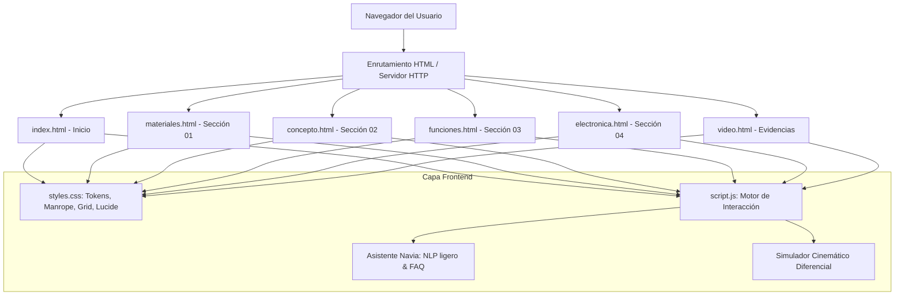
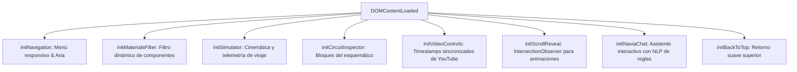
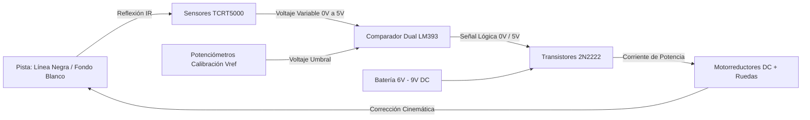

# ROBOTLAB: Robot Seguidor de Línea (Sin Arduino)
> **Proyecto Tecnológico y Académico · Grado 11 — Tecnología e Informática**  
> *Plataforma web educativa, interactiva y documentación técnica integral de robótica autónoma con control analógico discreto.*

---

## 📑 Tabla de Contenidos

- [Parte I: Arquitectura y Explicación Detallada del Código Web](#parte-i-arquitectura-y-explicación-detallada-del-código-web)
  - [1. Estructura General del Repositorio](#1-estructura-general-del-repositorio)
  - [2. Estructura Semántica de las Páginas HTML](#2-estructura-semántica-de-las-páginas-html)
  - [3. Sistema de Diseño y Hoja de Estilos (`styles.css`)](#3-sistema-de-diseño-y-hoja-de-estilos-stylescss)
  - [4. Lógica del Cliente e Interactividad (`script.js`)](#4-lógica-del-cliente-e-interactividad-scriptjs)
  - [5. Servidor Web y Configuración de Despliegue (`server.js` y `render.yaml`)](#5-servidor-web-y-configuración-de-despliegue-serverjs-y-renderyaml)
- [Parte II: Fundamentos Técnicos y Electrónica del Robot](#parte-ii-fundamentos-técnicos-y-electrónica-del-robot)
  - [1. Principio de Autonomía de Lazo Cerrado](#1-principio-de-autonomía-de-lazo-cerrado)
  - [2. Etapa de Detección Óptica (TCRT5000)](#2-etapa-de-detección-óptica-tcrt5000)
  - [3. Etapa de Comparación y Calibración (LM393)](#3-etapa-de-comparación-y-calibración-lm393)
  - [4. Etapa de Conmutación y Potencia (2N2222 + 1N4007)](#4-etapa-de-conmutación-y-potencia-2n2222--1n4007)
  - [5. Cinemática Diferencial y Tabla de Verdad](#5-cinemática-diferencial-y-tabla-de-verdad)
  - [6. Lista de Componentes y Despiece (BOM)](#6-lista-de-componentes-y-despiece-bom)
- [Parte III: Instrucciones de Ejecución Local](#parte-iii-instrucciones-de-ejecución-local)

---

# Parte I: Arquitectura y Explicación Detallada del Código Web

Esta primera sección detalla la arquitectura de software, patrones de diseño y cada módulo que compone el aplicativo web de ROBOTLAB.



---

## 1. Estructura General del Repositorio

El proyecto está diseñado bajo una arquitectura modular desacoplada, sin dependencias pesadas ni frameworks de empaquetado (cero overhead), optimizando la velocidad de carga (First Contentful Paint < 0.4s):

| Archivo / Carpeta | Propósito | Responsabilidad Técnica |
|---|---|---|
| `index.html` | Página de Inicio | Portal institucional, resumen ejecutivo de grado 11 y acceso a módulos. |
| `materiales.html` | Módulo 01: Materiales | Catálogo técnico de piezas, notas de taller y lista BOM estructurada. |
| `concepto.html` | Módulo 02: Concepto | Física de reflectancia óptica (\(\lambda = 950\text{ nm}\)) y comparativa Analógica vs Arduino. |
| `funciones.html` | Módulo 03: Funciones | Cinemática diferencial, tabla de verdad y simulador dinámico en tiempo real. |
| `electronica.html` | Módulo 04: Electrónica | Estudio esquemático, cálculo de divisores, comparador LM393 y transistores. |
| `video.html` | Evidencias y Video | Reproductor integrado con marcas de tiempo sincronizadas y catálogo de capturas. |
| `styles.css` | Hoja de Estilos Central | Variables CSS, sistema tipográfico, diseño responsivo y efectos visuales. |
| `script.js` | Lógica de Interacción | Navegación, asistente virtual Navia, simulador cinemático y scrollspy. |
| `server.js` | Servidor Node.js | Servidor HTTP estático nativo con manejo MIME y protección de rutas. |
| `render.yaml` | Infraestructura como Código | Manifiesto de despliegue automático para la nube de Render. |
| `package.json` | Metadatos y scripts | Definición del servicio y comando `npm start` para producción. |
| `navia.svg` | Identidad Gráfica | Vector escalable de la mascota y asistente técnico escolar. |

---

## 2. Estructura Semántica de las Páginas HTML

Todas las páginas comparten un estándar semántico riguroso para maximizar la accesibilidad (WCAG 2.1 AA) y el SEO técnico:

1. **`<head>` optimizado:**
   - Preconexión DNS a Google Fonts (`preconnect`).
   - Carga de las familias tipográficas seleccionadas: **Manrope** (encabezados principales y marca), **DM Sans** (cuerpo y navegación) e **IBM Plex Mono** (indicadores técnicos).
   - Metadatos `viewport`, `description` y enlace canónico de favicon SVG.
2. **Encabezado Global (`<header class="site-header">`):**
   - **Logotipo ROBOTLAB:** Emblema con icono geométrico estilizado en SVG, nombre con cambio cromático deliberado (`ROBOT` en `#17352f` y `LAB` en `#287E64`), junto al subtítulo técnico `PROYECTO TECNOLÓGICO · GRADO 11`.
   - **Badge de Estado / Sección:** Etiqueta compacta en `IBM Plex Mono` que indica la fase del curso sin quebrar la línea visual.
   - **Barra de Navegación (`.nav__menu`):** Lista horizontal en pantallas de escritorio con los 6 apartados oficiales e iconos lineales **Lucide** uniformes (`stroke-width: 1.8`, `18px`).
   - **Botón Hamburguesa (`.nav__toggle`):** Control accesible (`aria-expanded`, `aria-controls`) para dispositivos móviles.
3. **Cuerpo Principal (`<main>`):**
   - Encabezados de sección con breadcrumbs, título formal, badges de categorización y contenedor `.container` centrado a `1200px`.
4. **Pie de Página (`<footer class="site-footer">`):**
   - Resumen institucional, enlaces directos a las 6 secciones, fichas técnicas de referencia (datasheets de Texas Instruments y Vishay) y derechos educativos.
5. **Componentes Flotantes Globales:**
   - Botón interactivo de retorno al inicio (`#back-to-top`).
   - Lanzador flotante y modal conversacional de **Navia** (`#navia-launcher`, `#navia-chat`).

---

## 3. Sistema de Diseño y Hoja de Estilos (`styles.css`)

El archivo `styles.css` contiene más de 1900 líneas de reglas estructuradas en módulos independientes:

### 3.1 Tokens de Diseño y Variables CSS (`:root`)

```css
:root {
    /* Paleta Oficial ROBOTLAB */
    --color-dark-blue: #17352f;          /* Verde Pino Oscuro (texto principal / fondos oscuros) */
    --color-electric-blue: #287E64;      /* Verde Esmeralda Formal (marca y acento principal) */
    --color-electric-blue-dark: #1e634e; /* Sombra y hover interactivo */
    --color-turquoise: #D9F56B;          /* Amarillo Lima Tecnológico (contraste y llamadas) */
    --color-gray-50: #f5f8f4;            /* Fondo general claro de alta legibilidad */
    --color-gray-200: #dce5dc;           /* Bordes sutiles y separadores */

    /* Sistema Tipográfico Jerárquico */
    --font-heading: 'Manrope', system-ui, sans-serif;   /* Títulos principales y marca (peso 700) */
    --font-primary: 'DM Sans', system-ui, sans-serif;   /* Lectura general, botones y tabs */
    --font-mono: 'IBM Plex Mono', monospace;            /* Cintas técnicas, pines y fórmulas */
}
```

### 3.2 La Barra de Navegación y los Estados de Pestañas

Para cumplir con la especificación visual sin saltos de línea forzados:
- **Contenedor `.nav`:** `display: flex; white-space: nowrap; height: 4.6rem; align-items: center; justify-content: space-between;`.
- **Apartados inactivos:** Fondo `transparent`, texto en gris verdoso (`#4b5e53`) e iconos en verde pino (`#17352f`). Al pasar el cursor (`:hover`), adquieren un fondo tenue `rgba(40, 126, 100, 0.08)`.
- **Apartado activo (`.active`):** Fondo verde esmeralda `#287E64`, texto `#ffffff`, icono amarillo lima `#D9F56B` y bordes moderados redondeados a `8px`.
- **Transición:** `0.2s cubic-bezier(0.16, 1, 0.3, 1)` para un cambio suave y consistente en toda la interfaz.

### 3.3 Técnicas de Maquetación y Efectos Visuales

1. **CSS Grid y Flexbox Avanzado:**
   - Cuadrículas fluidas (`grid-template-columns: repeat(auto-fit, minmax(280px, 1fr))`) para las tarjetas de materiales, electrónica y comparaciones.
2. **Glassmorphism:**
   - La barra superior y el encabezado del chat emplean `backdrop-filter: blur(16px); background: rgba(255, 255, 255, 0.96);` para garantizar contraste sobre cualquier elemento en scroll.
3. **Efectos de Revelación al Desplazamiento (`.reveal`):**
   - Transiciones desacopladas mediante `transform: translateY(24px)` y `opacity: 0` que se activan con la clase `.active` asignada por JavaScript.

---

## 4. Lógica del Cliente e Interactividad (`script.js`)

El código JavaScript cliente está escrito en JavaScript estándar (ES6+), completamente modular y organizado en funciones con propósitos únicos:



### 4.1 Desglose de Funciones

1. **`initNavigation()`:**
   - Controla el menú móvil en pantallas pequeñas.
   - Alterna la clase `.open` sobre el contenedor `.nav__menu` y sincroniza dinámicamente `aria-expanded` entre `true` y `false`.
   - Cierra automáticamente el menú móvil cuando el usuario hace clic en cualquiera de las opciones de navegación.

2. **`initMaterialsFilter()`:**
   - En `materiales.html`, escucha los botones de categorías (Todos, Sensores, Potencia, Chasis, Pasivos).
   - Oculta o muestra dinámicamente las tarjetas mediante el atributo `data-category` sin recargar la página.

3. **`initSimulator()`:**
   - En `funciones.html`, gobierna el banco de pruebas interactivo del robot.
   - La función interna `setSimulationState(state)` acepta cuatro estados operacionales:
     * `'centrado'`: Ambos sensores leen blanco; ambos motores giran al 100% hacia adelante.
     * `'desviado-izquierda'`: El sensor izquierdo detecta la línea negra; el motor izquierdo se apaga (0 RPM) y el derecho empuja al 100%, forzando un pivote corrector a la derecha.
     * `'desviado-derecha'`: El sensor derecho detecta la línea; el motor derecho frena y el izquierdo tracciona.
     * `'fuera-pista'`: Pérdida de línea (ambos sensores en negro); parada de emergencia preventiva de ambos motores.
   - Actualiza en el DOM la telemetría en tiempo real: voltaje analógico, estado lógico del comparador (HIGH / LOW) y porcentaje de velocidad angular.

4. **`initCircuitInspector()`:**
   - En `electronica.html`, asocia eventos de selección a las diferentes etapas del circuito (Sensado, Comparación, Conmutación, Alimentación), resaltando la zona correspondiente del plano técnico y mostrando su explicación teórica.

5. **`initVideoControls()`:**
   - En `video.html`, sincroniza el reproductor `iframe` de YouTube con las 10 tarjetas de capturas técnicas.
   - Al pulsar "Ver en el Video", reescribe el parámetro `?start=SS&autoplay=1` del reproductor y realiza un desplazamiento suave (`scrollIntoView`) hacia el monitor de video.

6. **`initScrollReveal()`:**
   - Implementa un `IntersectionObserver` moderno para observar elementos con la clase `.reveal`.
   - Cuando un elemento entra al 15% del viewport, le inyecta la clase `.active`, activando la aceleración por hardware de la animación CSS.

7. **`initNaviaChat()`:**
   - Instancia el asistente escolar virtual flotante.
   - Posee una base de conocimiento estructurada (`NAVIA_FAQ`) con temas de electrónica, cinemática, polarización y resolución de fallas comunes en taller.
   - Aplica tokenización de texto y análisis de palabras clave para responder preguntas libres del estudiante, o despliega respuestas instantáneas mediante chips interactivos (`navia-chip`).

8. **`initBackToTop()`:**
   - Monitoriza el evento `scroll` de la ventana mediante un umbral de `300px` para mostrar u ocultar el botón flotante mediante el atributo booleano `hidden`.

---

## 5. Servidor Web y Configuración de Despliegue (`server.js` y `render.yaml`)

### 5.1 Servidor HTTP Nativo (`server.js`)
Para posibilitar la ejecución tanto como aplicación estática como servicio web en contenedores Node.js:
- Emplea el módulo nativo `http` de Node.js (cero dependencias externas en producción).
- Implementa una tabla de correspondencia MIME completa (`.html`, `.css`, `.js`, `.svg`, `.png`, `.json`).
- Previene vulnerabilidades de cruce de directorios (*Directory Traversal*) limpiando la ruta con `path.normalize()`.
- Soporta *Clean URLs* (si se solicita `/concepto`, resuelve automáticamente a `concepto.html`).
- Emite cabeceras de caché HTTP (`Cache-Control: public, max-age=3600`) para optimizar el rendimiento de red.

### 5.2 Manifiesto para Render (`render.yaml`)

```yaml
services:
  - type: web
    name: robotlab-grado11
    env: static
    buildCommand: ""
    publishDir: "./"
    pullRequestPreviewsEnabled: false
```
Esta directiva instruye a Render para desplegar el proyecto como un **Static Site** de alto rendimiento con CDN global inmediata.

---

# Parte II: Fundamentos Técnicos y Electrónica del Robot

Esta sección contiene la base teórica y la ingeniería de hardware que describe el funcionamiento físico del robot seguidor de línea móvil.



---

## 1. Principio de Autonomía de Lazo Cerrado

El robot es un sistema mecatrónico móvil terrestre de **lazo cerrado analógico (*closed-loop*)**.  
A diferencia de un sistema gobernado por microcontrolador que requiere ciclos de reloj, muestreo por interrupciones y código cargado en memoria Flash, este vehículo opera por **equilibrio de magnitudes físicas continuas**:

$$\text{Error de Posición } e(t) = V_{\text{sensor\_izq}}(t) - V_{\text{sensor\_der}}(t)$$

La señal de error se procesa instantáneamente por comparación de potencial, logrando un tiempo de respuesta de conmutación en el orden de los **microsegundos (\(\mu\text{s}\))**, superando la latencia de muestreo de muchos sistemas digitales programables de bajo costo.

---

## 2. Etapa de Detección Óptica (TCRT5000)

El robot utiliza dos sensores reflectivos ópticos **Vishay TCRT5000** montados en la parte inferior frontal a una distancia de \(3\text{ mm} \pm 1\text{ mm}\) de la superficie.

```
      +5V
       |
      [R1: 220Ω]
       |
     (LED IR) ---> [Luz Infrarroja λ = 950 nm]
       |                      |
      GND                     v
                      Superficie de Pista
                              | (Reflexión)
      +5V                     v
       |               (Fototransistor NPN)
     [Colector] <-------------+
       |
       +-----> V_out (Hacia Entrada Inversora LM393)
       |
      [R2: 10 kΩ]
       |
      GND
```

### Física de la Reflectancia:
1. **Fondo Blanco:** Coeficiente de reflexión elevado (\(\rho \approx 0.85\)). Los fotones infrarrojos rebotan e inciden en la base del fototransistor, polarizándolo en **saturación**. La corriente fluye a través de \(R_2\), elevando \(V_{\text{out}}\) a un valor alto (\(\approx 3.8\text{ V} - 4.5\text{ V}\)).
2. **Línea Negra:** La cinta aislante o pintura negra absorbe la longitud de onda infrarroja (\(\rho \approx 0.05\)). El fototransistor pasa a **corte**, la corriente cesa y el resistor pull-down drena la salida hacia tierra (\(V_{\text{out}} \approx 0.2\text{ V} - 0.6\text{ V}\)).

---

## 3. Etapa de Comparación y Calibración (LM393)

El circuito integrado **LM393** cuenta con dos comparadores de voltaje independientes de alta precisión en un encapsulado DIP-8:

$$V_{\text{out\_comp}} = \begin{cases} V_{CC} \text{ (a través de pull-up)} & \text{si } V_{(+)} > V_{(-)} \\ 0\text{ V (GND)} & \text{si } V_{(+)} < V_{(-)} \end{cases}$$

- La entrada inversora (\(V_{(-)}\)) recibe la señal analógica variable del sensor TCRT5000.
- La entrada no inversora (\(V_{(+)}\)) se conecta al terminal central de un potenciómetro multivuelta de \(10\text{ k}\Omega\), estableciendo un **voltaje de referencia (\(V_{\text{ref}}\))** ajustable entre \(0\text{ V}\) y \(5\text{ V}\).
- **Ajuste de Umbral:** Se ajusta \(V_{\text{ref}}\) al punto medio exacto de la ventana de transición:
  
  $$V_{\text{ref}} = \frac{V_{\text{blanco}} + V_{\text{negro}}}{2} \approx \frac{4.2\text{ V} + 0.4\text{ V}}{2} = 2.3\text{ V}$$

---

## 4. Etapa de Conmutación y Potencia (2N2222 + 1N4007)

Los comparadores LM393 no pueden suministrar la corriente directa requerida por los motores (típicamente \(150\text{ mA}\) a \(350\text{ mA}\) en carga). Por ello se utiliza una etapa amplificadora de conmutación:

1. **Resistor de Base (\(1\text{ k}\Omega\)):** Limita la corriente suministrada a la base del transistor NPN bipolar **2N2222A**, garantizando su entrada en la región de saturación profunda:
   
   $$I_B = \frac{V_{CC} - V_{BE}}{R_B} = \frac{5\text{ V} - 0.7\text{ V}}{1000\,\Omega} = 4.3\text{ mA}$$

   Con un \(h_{FE}\) mínimo de 100, el transistor soporta holgadamente hasta \(430\text{ mA}\) de corriente de colector (\(I_C\)).
2. **Diodo Flyback (1N4007):** Conectado en paralelo inverso a los bornes del motor inductivo. Al cortar la corriente de forma abrupta, la bobina del motor genera una fuerza contraelectromotriz (\(V = -L \frac{di}{dt}\)) que puede superar los \(60\text{ V}\). El diodo recircula este pulso destructivo a masa, salvaguardando la juntura semiconductora del transistor.

---

## 5. Cinemática Diferencial y Tabla de Verdad

El vehículo posee tracción diferencial compuesta por dos ruedas independientes con motorreductor y una rueda loca (*caster wheel*) pasiva libre en el extremo trasero o delantero.

### Matriz Lógica de Viraje

| Sensor Izq. (Pista) | Sensor Der. (Pista) | Motor Izquierdo | Motor Derecho | Acción Cinemática Resultante |
|:---:|:---:|:---:|:---:|:---|
| **Blanco** (\(V > V_{\text{ref}}\)) | **Blanco** (\(V > V_{\text{ref}}\)) | **ACTIVO** (100%) | **ACTIVO** (100%) | **Avance rectilíneo** (\(v_L = v_R\), radio de curvatura \(R = \infty\)) |
| **Negro** (\(V < V_{\text{ref}}\)) | **Blanco** (\(V > V_{\text{ref}}\)) | **APAGADO** (0%) | **ACTIVO** (100%) | **Pivote Izquierdo**: corrección angular hacia la línea |
| **Blanco** (\(V > V_{\text{ref}}\)) | **Negro** (\(V < V_{\text{ref}}\)) | **ACTIVO** (100%) | **APAGADO** (0%) | **Pivote Derecho**: corrección angular hacia la línea |
| **Negro** (\(V < V_{\text{ref}}\)) | **Negro** (\(V < V_{\text{ref}}\)) | **APAGADO** (0%) | **APAGADO** (0%) | **Parada de Seguridad**: robot fuera de la pista o cruce perpendicular |

---

## 6. Lista de Componentes y Despiece (BOM)

| Ítem | Componente | Denominación Técnica | Cantidad | Función en el Sistema |
|:---:|---|---|:---:|---|
| 1 | Sensor Óptico Infrarrojo | Vishay TCRT5000 | 2 | Detección de contraste de reflectancia en el suelo. |
| 2 | Circuito Integrado | LM393N (DIP-8) | 1 | Comparador analógico dual de alta precisión. |
| 3 | Transistor NPN | 2N2222A (TO-92) | 2 | Conmutador de potencia para activación de motores. |
| 4 | Diodo de Protección | 1N4007 (DO-41) | 2 | Supresión de corrientes inversas y f.c.e.m. inductiva. |
| 5 | Potenciómetro | Multivuelta \(10\text{ k}\Omega\) | 2 | Ajuste milimétrico de la tensión de umbral (\(V_{\text{ref}}\)). |
| 6 | Resistores de Polarización | \(220\,\Omega\) (1/4 W) | 2 | Limitadores de corriente para los emisores LED IR. |
| 7 | Resistores Pull-Down | \(10\text{ k}\Omega\) (1/4 W) | 2 | Divisor de tensión para fototransistores de sensado. |
| 8 | Resistores de Base | \(1\text{ k}\Omega\) (1/4 W) | 2 | Polarización en saturación de la base de los 2N2222. |
| 9 | Motorreductores DC | Tipo TT relación 48:1 (3V-6V) | 2 | Generación de par y tracción mecánica diferencial. |
| 10 | Ruedas de Goma | Diámetro 65 mm | 2 | Adherencia y transferencia cinemática al suelo. |
| 11 | Rueda Loca (Caster) | Esfera metálica / nylon | 1 | Soporte del tercer punto de equilibrio estático. |
| 12 | Portapilas / Batería | 4 pilas AA (6V) o Li-ion 7.4V | 1 | Fuente de energía electroquímica del sistema. |
| 13 | Chasis Acrílico | Corte láser 2 ruedas | 1 | Estructura mecánica portante del conjunto. |

---

# Parte III: Instrucciones de Ejecución Local

Para probar o continuar el desarrollo de este proyecto en tu entorno local:

### 1. Clonar el Repositorio
```bash
git clone https://github.com/Stellel-One/Mi-Primer-Robot.git
cd Mi-Primer-Robot
```

### 2. Ejecutar con Servidor Local Node.js
```bash
# Iniciar el servidor nativo configurado en package.json
npm start
```
Abre tu navegador en: `http://localhost:10000`

### 3. Ejecutar como Archivos Estáticos
También puedes abrir directamente cualquiera de los archivos `.html` (por ejemplo `index.html`) en tu navegador web de preferencia, o utilizar extensiones como **Live Server** de VSCode / Neovim.

---

## 🎓 Créditos y Marco Académico
- **Institución:** Colegio Técnico - Área de Tecnología e Informática.
- **Grado:** 11° de Educación Media Técnica.
- **Enfoque Pedagógico:** Comprensión de electrónica analógica fundamental, física del estado sólido y lógica de control sin dependencia de microcontroladores programables.
- **Licencia:** Proyecto abierto con fines estrictamente pedagógicos y formativos.
