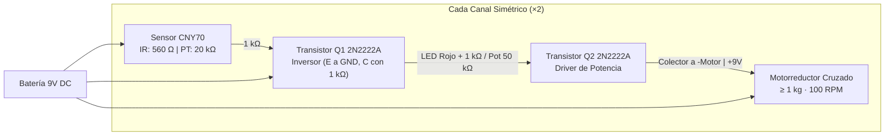

# 🤖 Robot Seguidor de Línea Negra (CNY70 + 2N2222A en Protoboard)
> **Institución Educativa Acevedo y Gómez (INACEGO) — Puerto Rico, Caquetá**  
> *Lema Institucional:* *"Servimos a la Comunidad y Formamos para la Vida"*  
> **Área:** Tecnología e Informática · Grado 11° de Educación Media Técnica  
> **🌐 Sitio Web Oficial en Producción:** [https://mi-primer-robot.onrender.com](https://mi-primer-robot.onrender.com)  
> **📦 Repositorio GitHub:** [https://github.com/Stellel-One/Mi-Primer-Robot](https://github.com/Stellel-One/Mi-Primer-Robot)  
> **🎥 Tutorial Base de Referencia:** [El Profe García — Robot Seguidor de Línea Negra](https://youtu.be/W9Uy-wgD5Vc)

*(Nota: La versión previa basada en BBC Micro:bit + Puente H L298N + Rover Mini se conserva intacta en la rama `version-microbit-l298n`.)*

---

## 🏫 Presentación del Proyecto

Este proyecto documenta el diseño, montaje sobre protoboard, calibración y funcionamiento de un **Robot Seguidor de Línea Negra 100% Analógico**, sin microcontroladores ni programación.

El sistema emplea **dos sensores ópticos reflectivos CNY70**, **cuatro transistores bipolares NPN 2N2222A** (dos etapas en cascada por canal), una red discreta de resistencias (`560 Ω`, `20 kΩ`, `1 kΩ`), **dos LEDs rojos** indicadores, **dos motorreductores de mínimo 1 kg de fuerza (~100 RPM)** con sus llantas y una única **batería de 9V**.

---

## 🔬 Arquitectura Circuital Analógica



### Regla Mecánica Clave (Control Cruzado):
1. Ambos sensores **CNY70** se orientan hacia el suelo **sobre la línea negra**.
2. Al pisar la línea negra, el LED IR no rebota → `Q1` entra en corte → se enciende el **LED rojo** y satura `Q2` → el **motor del lado contrario** gira.
3. Si un sensor se sale hacia la superficie blanca, `Q1` conduce a tierra → apaga el LED rojo y corta `Q2` → detiene ese motor para que la rueda activa opuesta devuelva el robot a la línea negra.

---

## 📋 Lista Oficial de Materiales (11 Componentes)

| # | Componente | Especificación Exacta | Cant. | Código / Función |
|:---:|:---|:---|:---:|:---|
| **01** | **Sensores Ópticos** | CNY70 (Emisor IR + Fototransistor) | 2 | Detectan la línea negra frente a la superficie blanca. |
| **02** | **Resistencias IR** | 560 Ω (1/4 W) | 2 | Limitan la corriente del LED emisor infrarrojo a +9V. |
| **03** | **Resistencias Sensor** | 20 kΩ (1/4 W) | 2 | Pull-down a tierra en el emisor del fototransistor CNY70. |
| **04** | **Resistencias de Etapa** | 1 kΩ (1/4 W) · *Café-Negro-Rojo* | 6 | 3 por canal: base Q1, colector Q1 y base Q2 *(o pot. 50 kΩ en Q2)*. |
| **05** | **Transistores NPN** | 2N2222A (TO-92: E - B - C) | 4 | 2 por canal: Q1 inversor lógico + Q2 driver de potencia. |
| **06** | **Indicadores Visuales** | Diodos LED rojos (5 mm) | 2 | Encienden al detectar línea negra (ánodo al colector de Q1). |
| **07** | **Motorreductores** | DC mínimo 1 kg de fuerza (~100 RPM) | 2 | Tracción diferencial cruzada capaz de mover el peso total. |
| **08** | **Llantas** | Ruedas para motorreductor | 2 | Acoplamiento mecánico y adherencia a la pista. |
| **09** | **Fuente de Energía** | Batería rectangular de 9V | 1 | Alimentación única conectada a los buses de la protoboard. |
| **10** | **Placa / Chasis** | Protoboard estándar | 1 | Soporte estructural y matriz de conexiones sin soldadura. |
| **11** | **Cableado** | Cables para conectar | Varios | Puentes, extensión frontal de CNY70 y cruce de motores. |

---

## 💻 Secciones de la Plataforma Web

- `index.html` — Portal institucional **INACEGO**, ficha técnica del prototipo analógico y acceso curricular.
- `materiales.html` — Catálogo ilustrado de los 11 materiales exactos con filtros y tabla BOM.
- `concepto.html` — Autonomía en lazo cerrado, reflectancia IR en el CNY70 y comparativa analógico vs. microcontroladores.
- `funciones.html` — Ciclo de 5 etapas, tip de calibración (`1 kΩ` vs potenciómetro `50 kΩ`), control cruzado y aplicaciones industriales.
- `electronica.html` — Desglose de `Q1`/`Q2` (`2N2222A`), esquema SVG completo de ambos canales en `+9V`/`GND`, guía paso a paso en protoboard e inspector interactivo.
- `video.html` — Reproductor del tutorial oficial (`W9Uy-wgD5Vc`) con saltos sincronizados a las 6 marcas de tiempo reales (`00:00`, `00:31`, `01:07`, `01:50`, `02:32`, `02:56`).
- `script.js` — Filtro de materiales, inspector circuital, reproductor con saltos temporales y asistente **Navia** actualizado.

---

## 🚀 Ejecución Local y Despliegue

```bash
git clone https://github.com/Stellel-One/Mi-Primer-Robot.git
cd Mi-Primer-Robot
npm start   # Inicia server.js en http://localhost:10000
```

Desplegado automáticamente desde `master` como sitio estático en Render (`render.yaml`): [https://mi-primer-robot.onrender.com](https://mi-primer-robot.onrender.com).
